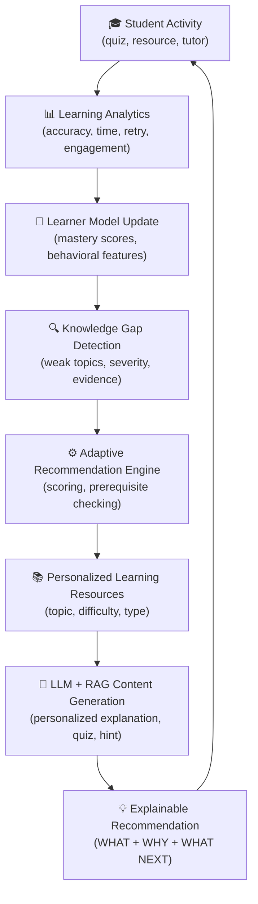
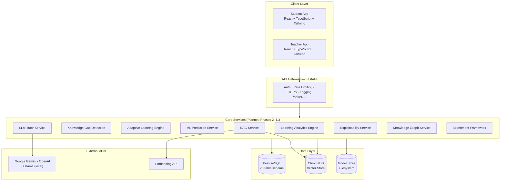
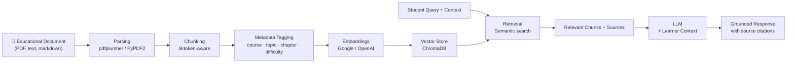

# Explainable AI-Powered Adaptive Learning Platform
### Using Learning Analytics and Large Language Models for Personalized Education

> A research-oriented adaptive learning platform combining learning analytics, dynamic learner modeling, knowledge-gap detection, machine learning, personalized recommendations, LLM-powered tutoring, explainable AI, and RAG to deliver genuinely individualized education experiences.


> **⚠️ Active Development** — This project is being built incrementally across 14 phases. Phase 1 (Foundation) is complete. See the [Implementation Status](#current-implementation-status) section for an honest per-module breakdown.

---

## Table of Contents

1. [Project Overview](#project-overview)
2. [Research Problem](#research-problem)
3. [Key Objectives](#key-objectives)
4. [Core Features](#core-features)
5. [System Architecture](#system-architecture)
6. [Component Architecture](#component-architecture)
7. [Adaptive Learning Workflow](#adaptive-learning-workflow)
8. [Technology Stack](#technology-stack)
9. [Project Structure](#project-structure)
10. [Database Design](#database-design)
11. [Frontend Application](#frontend-application)
12. [API Overview](#api-overview)
13. [Installation](#installation)
14. [Configuration](#configuration)
15. [Running the Application](#running-the-application)
16. [Testing](#testing)
17. [Data and Dataset Strategy](#data-and-dataset-strategy)
18. [Machine Learning Pipeline](#machine-learning-pipeline)
19. [LLM Architecture](#llm-architecture)
20. [RAG Pipeline](#rag-pipeline)
21. [Educational Knowledge Graph](#educational-knowledge-graph)
22. [Explainability and Recommendation Confidence](#explainability-and-recommendation-confidence)
23. [Research Experiment Framework](#research-experiment-framework)
24. [Evaluation](#evaluation)
25. [Development Roadmap](#development-roadmap)
26. [Current Implementation Status](#current-implementation-status)
27. [Research Contribution](#research-contribution)
28. [Limitations](#limitations)
29. [Future Work](#future-work)
30. [Documentation](#documentation)
31. [Contributing](#contributing)
32. [License](#license)

---

## Project Overview

One-size-fits-all education fails students because different learners have different mastery levels for different concepts — even within the same class and course. A student who has mastered functions may still struggle with recursion. A student who understands OOP may have never solidified their understanding of data structures. Yet traditional learning systems present the same material to every student in the same order.

This platform is designed around a **continuous adaptive feedback loop**:



The system never recommends the same learning path to every student. Recommendations are derived from each student's own interaction data, mastery estimates, knowledge gaps, and prerequisite relationships — not from hard-coded rules.

---

## Research Problem

**Central Research Question:**

> Can an explainable adaptive learning framework integrating learning analytics and LLM-based content generation improve student learning outcomes, engagement, and trust compared with conventional non-adaptive learning?

**Research Hypotheses** *(to be tested with real participant data — not yet evaluated)*:

| Hypothesis | Description |
|---|---|
| H1 | Adaptive learning significantly improves learning gains vs. non-adaptive learning |
| H2 | Personalized LLM-generated content improves student engagement |
| H3 | Explainable recommendations increase student trust in the system |
| H4 | Combining behavioral and performance signals improves knowledge-gap prediction accuracy |
| H5 | Adaptive difficulty improves learning efficiency (time to mastery) |

> **Important:** The platform provides the software infrastructure to test these hypotheses in a controlled study. No experimental conclusions can be drawn until real participant data is collected.

---

## Key Objectives

| Objective | Description | Status |
|---|---|---|
| Dynamic Learner Modeling | Continuously updated learner profiles with mastery, behavior, and history | ✅ Schema implemented |
| Learning Analytics Engine | Behavioral and performance analysis across sessions | ⏳ Planned (Phase 2) |
| Knowledge Gap Detection | Multi-signal identification of weak concepts with evidence | ⏳ Planned (Phase 3) |
| ML Prediction | Predictive models for mastery and learning risk | ⏳ Planned (Phase 4) |
| Adaptive Recommendation | Personalized next-best learning actions with scoring | ⏳ Planned (Phase 5) |
| LLM Tutor | Context-aware personalized explanations, hints, and quizzes | ⏳ Planned (Phase 6) |
| RAG | Trusted knowledge retrieval from educational documents | ⏳ Planned (Phase 7) |
| Explainable AI | Human-readable recommendation explanations with SHAP/LIME | ⏳ Planned (Phase 8) |
| Knowledge Graph | Prerequisite-aware concept relationships driving adaptive logic | ⏳ Planned (Phase 9) |
| Student Dashboard | Full analytics, learning path, tutor, quiz, and study plan UI | 🟡 Partial (Phase 10) |
| Teacher Dashboard | Class analytics, at-risk detection, learner inspection | 🟡 Partial (Phase 10) |
| Research Experiments | Controlled experiment groups with pre/post-test evaluation | ⏳ Planned (Phase 11) |
| Statistical Analysis | Proper assumption-checked statistical tests | ⏳ Planned (Phase 11) |
| Ablation Study | Component-by-component contribution analysis | ⏳ Planned (Phase 11) |

---

## Core Features

### ✅ Implemented (Phase 1 — Foundation)

**Authentication & Security**
- Student and teacher registration with role-specific profiles
- Bcrypt password hashing (12 rounds)
- JWT access tokens (30-minute expiry) + JWT refresh tokens (7-day expiry)
- Role-based route protection (student / teacher roles)
- Rate limiting via SlowAPI (configurable per-minute limits)
- Input validation via Pydantic v2 schemas
- Structured JSON logging of authentication events
- CORS configuration for frontend

**Database Schema (25 entities designed, schema active)**
- Complete PostgreSQL schema covering all planned system components
- UUID primary keys throughout
- Normalized design with proper foreign keys and constraints

**Frontend Shell**
- React 18 + TypeScript + Tailwind CSS (dark theme)
- Login and Register pages (connected to live API)
- Student dashboard (layout + demo data, pending Phase 2 API integration)
- Teacher dashboard (layout + demo data, pending Phase 2 API integration)
- Role-based routing and protected routes
- Toast notifications, loading states

### ⏳ Planned (Phases 2–14)

**Learner Intelligence** — Dynamic learner profiles, topic mastery tracking, engagement analytics, behavioral event tracking

**Knowledge Intelligence** — Knowledge gap detection with multi-signal evidence, prerequisite analysis, repeated mistake detection

**Adaptive Learning** — Personalized recommendations, difficulty adaptation, adaptive learning paths, personalized study plans

**AI and LLM Features** — Personalized explanations, Socratic tutoring, hints, quiz generation, feedback generation

**Explainability** — SHAP values, LIME, feature importance, human-readable recommendation evidence, confidence/probability distinction

**Knowledge Retrieval (RAG)** — Document ingestion, chunking, embeddings, ChromaDB vector search, source citations, grounded responses

**Analytics Dashboards** — Progress charts, mastery visualizations, class analytics, at-risk detection

**Research Framework** — Experiment groups, pre/post testing, retention measurement, statistical analysis, ablation study

---

## System Architecture



> ✅ = Implemented | 🟡 = Partial | ⏳ = Planned

The **Auth** layer is fully implemented. The **Services** layer has its directory structure and database schema in place; the service logic is planned for Phases 2–11.

---

## Component Architecture

| Component | Responsibility | Technologies | Status |
|---|---|---|---|
| Frontend | Student and teacher UI | React 18, TypeScript, Tailwind, Vite | 🟡 Auth + dashboard shells |
| FastAPI Backend | REST API, request routing, dependency injection | FastAPI, Pydantic v2, Uvicorn | ✅ Auth routes working |
| Auth Service | JWT, password hashing, role management | python-jose, passlib/bcrypt | ✅ Implemented |
| PostgreSQL Schema | Persistent application data | SQLAlchemy 2.0, Alembic | ✅ 25-table schema + migrations |
| Learning Analytics | Behavioral feature engineering | pandas, numpy, scikit-learn | ⏳ Phase 2 |
| ML Pipeline | Training, prediction, evaluation | scikit-learn, XGBoost, LightGBM | ⏳ Phase 4 |
| Adaptive Engine | Personalized recommendation scoring | Python (rule + ML hybrid) | ⏳ Phase 5 |
| LLM Layer | Personalized educational generation | Google Gemini / OpenAI / Ollama | ⏳ Phase 6 |
| RAG Service | Document retrieval and grounded generation | ChromaDB, pdfplumber, tiktoken | ⏳ Phase 7 |
| Explainability | SHAP/LIME + human-readable explanations | shap, lime | ⏳ Phase 8 |
| Knowledge Graph | Prerequisite concept relationships | networkx | ⏳ Phase 9 |
| Experiment Framework | Research study tracking | Python, PostgreSQL | ⏳ Phase 11 |

---

## Adaptive Learning Workflow

*This section describes the intended workflow. The full pipeline is implemented in Phases 2–12. The database schema and service stubs are already in place.*

The platform is not a static course delivery system. It adapts based on each student's actual behavior and performance:

**Step 1 — Event Capture:** Every student action is recorded as a `StudentEvent` (resource view, quiz attempt, hint request, video completion, topic revisit).

**Step 2 — Analytics Processing:** The Learning Analytics Engine aggregates events into derived features: recent accuracy, average accuracy, accuracy trend, time-per-question, retry rate, skip rate, engagement score, consistency score.

**Step 3 — Mastery Update:** The system updates `StudentTopicMastery` records with a mastery score (0.0–1.0), confidence estimate, mastery level, and recent/average accuracy.

**Step 4 — Knowledge Gap Detection:** The Knowledge Gap Engine evaluates each topic against multiple signals — not just a threshold — and produces a `KnowledgeGap` record with gap score, severity, priority, evidence, affected concepts, and prerequisite information.

**Step 5 — Prerequisite Checking:** Before recommending a topic, the Adaptive Engine checks whether prerequisite topics are sufficiently mastered, using the knowledge graph and the `Prerequisite` table.

**Step 6 — Recommendation Scoring:** Each candidate learning action is scored using a weighted combination of: gap score, mastery deficit, accuracy deficit, prerequisite readiness, engagement signals, and ML model confidence. Weights are configurable via environment variables.

**Step 7 — Explainability:** The Explainability Service produces `RecommendationEvidence` records with factor names, values, SHAP values (where ML is used), and human-readable explanations — answering **WHAT**, **WHY**, and **WHAT NEXT** for every recommendation.

**Step 8 — LLM Content Generation:** The LLM Tutor Service receives learner context (topic, mastery score, difficulty level, previous mistakes, learning objective) and generates personalized explanations, examples, hints, and quiz questions. RAG context from trusted course documents is injected where available.

**Step 9 — New Interaction → Loop Continues:** The student's interaction with the recommended content generates new events, which restart the cycle.

> **Important distinction:** Deterministic scoring rules, ML model probabilities, recommendation scores, and confidence estimates are treated as separate quantities and are not conflated. This distinction is architecturally enforced.

---

## Technology Stack

### Backend
| Category | Technology | Version |
|---|---|---|
| Web Framework | FastAPI | ≥0.110 |
| ASGI Server | Uvicorn | ≥0.27 |
| Data Validation | Pydantic | v2 |
| ORM | SQLAlchemy | 2.0 |
| Migrations | Alembic | ≥1.13 |
| Auth | python-jose, passlib/bcrypt | latest |
| Rate Limiting | SlowAPI | ≥0.1.9 |

### Database & Storage
| Category | Technology |
|---|---|
| Primary Database | PostgreSQL 15 |
| Vector Store | ChromaDB (pgvector optional) |
| Document Parsing | pdfplumber, PyPDF2 |
| File Storage | Local filesystem |

### Machine Learning *(packages declared, implementation planned)*
| Package | Purpose |
|---|---|
| scikit-learn | Logistic Regression, Random Forest, preprocessing |
| XGBoost | Gradient boosting for performance prediction |
| LightGBM | Fast gradient boosting (planned comparison) |
| SHAP | Explainability — global and local feature attribution |
| LIME | Local surrogate model explanations |
| pandas, numpy | Data processing and feature engineering |
| scipy | Statistical analysis |
| matplotlib, seaborn | Research visualizations |
| networkx | Educational knowledge graph |

### LLM & Embeddings *(configured, service layer planned)*
| Provider | Model | Role |
|---|---|---|
| Google Gemini | gemini-1.5-flash (default) | Primary LLM provider |
| OpenAI | gpt-4o-mini (optional) | Alternative provider |
| Ollama | llama3.2 (optional) | Local/offline fallback |

### Frontend
| Technology | Purpose |
|---|---|
| React 18 | UI framework |
| TypeScript | Type safety |
| Vite | Build tool |
| Tailwind CSS 3 | Styling |
| React Router v6 | Routing |
| TanStack Query | Server state management |
| Zustand | Client state management |
| Recharts | Data visualization |
| React Hook Form + Zod | Form validation |
| Axios | HTTP client |
| Lucide React | Icon library |

### Testing & Quality
| Tool | Purpose |
|---|---|
| pytest | Backend unit and API tests |
| pytest-asyncio | Async test support |
| FastAPI TestClient | In-process API testing |
| SQLite (test DB) | Fast in-memory test database |
| Faker | Synthetic test data generation |
| Vitest | Frontend unit testing |

### DevOps
| Tool | Purpose |
|---|---|
| Docker | Containerization |
| Docker Compose | Local orchestration (PostgreSQL + backend + frontend) |
| Alembic | Database migration management |

---

## Project Structure

```text
adaptive-learning-platform/
│
├── README.md
├── .env.example                    # Environment variable template
├── .gitignore
├── docker-compose.yml              # PostgreSQL + backend + frontend
│
├── backend/
│   ├── Dockerfile
│   ├── requirements.txt            # All Python dependencies
│   ├── alembic.ini
│   ├── pytest.ini
│   ├── app/
│   │   ├── main.py                 # ✅ FastAPI app factory, lifespan, CORS, rate limiting
│   │   ├── config.py               # ✅ Pydantic-settings configuration
│   │   ├── dependencies.py         # ✅ FastAPI dependency injection helpers
│   │   ├── api/
│   │   │   ├── router.py           # ✅ Main API router (v1 prefix)
│   │   │   └── v1/
│   │   │       └── auth.py         # ✅ Register / Login / Refresh endpoints
│   │   ├── core/
│   │   │   ├── database.py         # ✅ SQLAlchemy engine + session + Base
│   │   │   ├── security.py         # ✅ bcrypt hashing + JWT creation/validation
│   │   │   ├── exceptions.py       # ✅ Custom HTTP exception handlers
│   │   │   └── logging.py          # ✅ Structured JSON logging
│   │   ├── models/
│   │   │   └── models.py           # ✅ 25-table SQLAlchemy ORM schema
│   │   ├── schemas/
│   │   │   ├── auth.py             # ✅ Auth request/response schemas
│   │   │   └── common.py           # ✅ Shared response wrappers
│   │   ├── analytics/              # ⏳ Learning Analytics Engine (Phase 2)
│   │   ├── knowledge_gap/          # ⏳ Knowledge Gap Detection (Phase 3)
│   │   ├── ml/                     # ⏳ ML Prediction Service (Phase 4)
│   │   ├── adaptive/               # ⏳ Adaptive Learning Engine (Phase 5)
│   │   ├── llm/                    # ⏳ LLM Tutor Service (Phase 6)
│   │   ├── rag/                    # ⏳ RAG Service (Phase 7)
│   │   ├── explainability/         # ⏳ Explainability Service (Phase 8)
│   │   ├── knowledge_graph/        # ⏳ Knowledge Graph Service (Phase 9)
│   │   ├── experiments/            # ⏳ Research Experiment Framework (Phase 11)
│   │   ├── services/               # ⏳ Application services (Phase 2+)
│   │   └── repositories/           # ⏳ Database access layer (Phase 2+)
│   ├── migrations/
│   │   ├── env.py                  # ✅ Alembic migration environment
│   │   └── versions/               # Database migration history
│   └── tests/
│       ├── conftest.py             # ✅ Shared fixtures, test DB setup
│       ├── api/
│       │   └── test_auth.py        # ✅ 15 auth endpoint tests
│       └── unit/
│           └── test_security.py    # ✅ JWT + password hashing unit tests
│
├── frontend/
│   ├── package.json
│   ├── vite.config.ts
│   ├── tailwind.config.js
│   ├── tsconfig.json
│   └── src/
│       ├── App.tsx                 # ✅ Routing + role-based protection
│       ├── main.tsx
│       ├── index.css               # ✅ Global styles + design tokens
│       ├── pages/
│       │   ├── auth/
│       │   │   ├── LoginPage.tsx   # ✅ Connected to auth API
│       │   │   └── RegisterPage.tsx# ✅ Student/teacher registration
│       │   ├── dashboard/
│       │   │   └── DashboardPage.tsx # 🟡 Layout done, uses demo data
│       │   ├── teacher/
│       │   │   └── TeacherDashboardPage.tsx # 🟡 Layout done, uses demo data
│       │   ├── courses/            # ⏳ Phase 10
│       │   ├── quiz/               # ⏳ Phase 10
│       │   ├── tutor/              # ⏳ Phase 10
│       │   └── analytics/          # ⏳ Phase 10
│       ├── components/
│       │   └── ui/
│       │       └── AppLayout.tsx   # ✅ Navigation shell
│       ├── services/
│       │   ├── apiClient.ts        # ✅ Axios client with token injection
│       │   └── authService.ts      # ✅ Auth API service
│       └── store/
│           └── authStore.ts        # ✅ Zustand auth state
│
├── notebooks/                      # ⏳ Jupyter notebooks (Phase 2+)
├── ml/                             # ⏳ ML pipeline modules (Phase 4+)
├── data/
│   ├── raw/                        # Public datasets
│   ├── processed/                  # Processed feature data
│   └── synthetic/                  # Synthetic demo student data
├── models/                         # ⏳ Trained model artifacts (Phase 4+)
├── rag/
│   └── documents/                  # Educational documents for RAG
├── knowledge_graph/                # ⏳ Graph definitions (Phase 9+)
├── experiments/                    # ⏳ Experiment configs and results
├── reports/                        # Research reports and figures
├── scripts/                        # Utility scripts
└── docs/
    ├── architecture.md             # ✅ Full system architecture
    ├── implementation-plan.md      # ✅ Phased implementation plan
    └── research-methodology.md    # ✅ Research design document
```

---

## Database Design

The database schema is fully designed and declared in SQLAlchemy ORM. It covers all planned system components.

### Entity Groups

| Group | Tables |
|---|---|
| **Identity** | `users`, `students`, `teachers` |
| **Content** | `courses`, `topics`, `subtopics`, `prerequisites`, `learning_resources` |
| **Assessment** | `questions`, `question_options`, `quizzes`, `quiz_questions`, `quiz_attempts`, `student_answers` |
| **Learning Analytics** | `learning_sessions`, `student_events`, `student_topic_mastery` |
| **Learner Modeling** | `learner_profiles`, `knowledge_gaps` |
| **Recommendations** | `recommendations`, `recommendation_evidence` |
| **Study Plans** | `study_plans`, `study_plan_items` |
| **LLM / AI Tutor** | `llm_conversations`, `llm_messages` |
| **RAG** | `rag_documents`, `rag_chunks` |
| **Knowledge Graph** | `knowledge_graph_nodes`, `knowledge_graph_edges` |
| **Explainability** | `model_predictions`, `model_explanations` |
| **Research** | `experiments`, `experiment_participants`, `experiment_results` |
| **Feedback** | `feedback` |

### Key Design Decisions

- **UUID primary keys** throughout to support distributed data sources
- **`StudentTopicMastery`** stores mastery score, confidence, attempts, correct count, recent accuracy, and mastery level (not_started / beginner / intermediate / advanced / mastered)
- **`LearnerProfile`** aggregates weak/strong topics, current learning path, recommendation history, intervention history, and engagement score — updated after each analytics run
- **`KnowledgeGap`** includes gap score, severity, priority, evidence (JSON), affected concepts, prerequisite information, and confidence — enabling full XAI transparency
- **`Recommendation`** and **`RecommendationEvidence`** are separate tables — each recommendation stores its evidence as structured factor-level records (factor name, value, weight, SHAP value, human explanation)
- **`ModelPrediction`** and **`ModelExplanation`** log every ML inference with features and SHAP/LIME values for audit and retrospective evaluation
- **`Experiment` / `ExperimentParticipant` / `ExperimentResult`** implement the three-group research design (Traditional / AI Adaptive / Explainable AI Adaptive)
- `metadata` column names are renamed to `resource_metadata`, `doc_metadata`, `chunk_metadata` throughout to avoid SQLAlchemy reserved name conflicts

---

## Frontend Application

### Student Routes

| Route | Page | Status |
|---|---|---|
| `/login` | Login | ✅ Implemented |
| `/register` | Register | ✅ Implemented |
| `/dashboard` | Student Dashboard | 🟡 Shell with demo data |
| `/courses` | Course Catalog | ⏳ Phase 10 |
| `/learning-path` | Adaptive Learning Path | ⏳ Phase 10 |
| `/tutor` | AI Tutor Chat | ⏳ Phase 10 |
| `/quiz/:id` | Quiz Interface | ⏳ Phase 10 |
| `/study-plan` | Daily Study Plan | ⏳ Phase 10 |
| `/recommendations` | Recommendations + Explanations | ⏳ Phase 10 |
| `/analytics` | Progress Analytics | ⏳ Phase 10 |
| `/profile` | Profile & Settings | ⏳ Phase 10 |

### Teacher Routes

| Route | Page | Status |
|---|---|---|
| `/teacher/dashboard` | Class Overview | 🟡 Shell with demo data |
| `/teacher/students` | Student List | ⏳ Phase 10 |
| `/teacher/students/:id` | Individual Learner Profile | ⏳ Phase 10 |
| `/teacher/analytics` | Class Analytics | ⏳ Phase 10 |

### Dashboard Demo Data

Both dashboard pages display clearly labeled **DEMO DATA** badges (⚠️ `DEMO DATA — Synthetic`). The dashboard UI demonstrates the intended layout including:

- **Student Dashboard:** overall mastery stat cards, per-topic mastery bars with color coding (strong/moderate/weak), today's study plan activities, personalized recommendation cards with "Why recommended?" panels
- **Teacher Dashboard:** class stat cards (total students, at-risk count, average mastery, total knowledge gaps), student overview with risk badges, class-wide knowledge gap table

This demo data will be replaced with live API calls in Phase 2.

---

## API Overview

### Currently Implemented Endpoints

| Method | Endpoint | Description | Auth |
|---|---|---|---|
| `GET` | `/health` | Health check with DB connectivity | None |
| `POST` | `/api/v1/auth/register` | Register student or teacher | None |
| `POST` | `/api/v1/auth/login` | Authenticate and get JWT tokens | None |
| `POST` | `/api/v1/auth/refresh` | Exchange refresh token for new access token | None |

### Planned Endpoints *(architecture defined, not yet implemented)*

```text
GET  /api/v1/students/me
GET  /api/v1/students/me/profile
GET  /api/v1/students/me/mastery
GET  /api/v1/students/me/recommendations
GET  /api/v1/students/me/study-plan
GET  /api/v1/students/me/progress

GET  /api/v1/courses
GET  /api/v1/courses/{course_id}
GET  /api/v1/topics/{topic_id}

POST /api/v1/quizzes/{quiz_id}/attempt
GET  /api/v1/quiz-attempts/{attempt_id}

POST /api/v1/tutor/chat
POST /api/v1/tutor/explain
POST /api/v1/tutor/hint
POST /api/v1/tutor/generate-quiz

GET  /api/v1/recommendations
GET  /api/v1/recommendations/{id}/explanation

GET  /api/v1/teacher/dashboard
GET  /api/v1/teacher/students
GET  /api/v1/teacher/students/{id}

GET  /api/v1/analytics/learning
GET  /api/v1/analytics/class

POST /api/v1/documents/upload
POST /api/v1/documents/index

GET  /api/v1/experiments
POST /api/v1/experiments
GET  /api/v1/experiments/{id}/results
```

**Interactive API Documentation:** Available at `http://localhost:8000/docs` (Swagger UI) and `http://localhost:8000/redoc` when running in development mode.

---

## Installation

### Prerequisites

| Requirement | Version | Notes |
|---|---|---|
| Python | 3.12+ | Required for backend |
| Node.js | 18+ | Required for frontend |
| PostgreSQL | 15+ | Required for production (SQLite used in tests) |
| Docker + Docker Compose | Latest | Optional but recommended |

### Clone

```bash
git clone https://github.com/<your-username>/adaptive-learning-platform.git
cd adaptive-learning-platform
```

### Environment Setup

```bash
cp .env.example .env
# Edit .env and fill in real values — especially:
# - DATABASE_URL
# - JWT_SECRET_KEY
# - SECRET_KEY
# - GOOGLE_API_KEY (or OPENAI_API_KEY)
```

> **Never commit `.env` to version control.** The `.gitignore` already excludes it.

### Backend Setup

```bash
cd backend

# Create virtual environment
python -m venv .venv

# Activate virtual environment
# Windows:
.venv\Scripts\activate
# macOS/Linux:
source .venv/bin/activate

# Install dependencies
pip install -r requirements.txt
```

### Database Setup

```bash
# Create PostgreSQL database (if not using Docker)
createdb adaptive_learning

# Run database migrations
cd backend
alembic upgrade head
```

### Frontend Setup

```bash
cd frontend
npm install
```

---

## Running the Application

### Option A — Manual (Development)

**Backend:**
```bash
cd backend
uvicorn app.main:app --reload --host 0.0.0.0 --port 8000
```

**Frontend:**
```bash
cd frontend
npm run dev
```

- Backend API: `http://localhost:8000`
- API Documentation: `http://localhost:8000/docs`
- Frontend: `http://localhost:5173`

### Option B — Docker Compose

```bash
# Start all services (PostgreSQL + backend + frontend)
docker compose up --build

# Run migrations inside the container
docker compose exec backend alembic upgrade head
```

> **Note:** The frontend `Dockerfile` is not yet present in the repository. Docker Compose works for PostgreSQL and backend; the frontend currently runs manually with `npm run dev`.

---

## Configuration

All configuration is managed via environment variables. Copy `.env.example` to `.env` and set real values.

| Variable | Purpose | Required |
|---|---|---|
| `DATABASE_URL` | PostgreSQL connection string | Yes |
| `SECRET_KEY` | Application secret | Yes |
| `JWT_SECRET_KEY` | JWT signing secret (≥32 chars) | Yes |
| `JWT_ACCESS_TOKEN_EXPIRE_MINUTES` | Access token lifetime | No (default: 30) |
| `JWT_REFRESH_TOKEN_EXPIRE_DAYS` | Refresh token lifetime | No (default: 7) |
| `LLM_PROVIDER` | `google` / `openai` / `local` | No (default: google) |
| `GOOGLE_API_KEY` | Google Gemini API key | If using Google |
| `OPENAI_API_KEY` | OpenAI API key | If using OpenAI |
| `OLLAMA_BASE_URL` | Ollama base URL | If using local LLM |
| `VECTOR_STORE` | `chromadb` / `pgvector` | No (default: chromadb) |
| `CHROMA_PERSIST_DIR` | ChromaDB persistence path | No |
| `MODEL_STORE_DIR` | Directory for saved ML models | No |
| `RANDOM_SEED` | ML reproducibility seed | No (default: 42) |
| `RATE_LIMIT_PER_MINUTE` | API rate limit | No (default: 60) |
| `LLM_RATE_LIMIT_PER_MINUTE` | LLM endpoint rate limit | No (default: 10) |
| `ALLOWED_ORIGINS` | CORS allowed origins (comma-separated) | No |
| `LOG_LEVEL` | Logging level | No (default: INFO) |
| `APP_ENV` | `development` / `staging` / `production` | No |

> In production, Swagger UI (`/docs`) and ReDoc (`/redoc`) are automatically disabled.

---

## Testing

### Running Tests

```bash
cd backend

# Run all tests
pytest

# Run with verbose output
pytest -v

# Run specific test files
pytest tests/api/test_auth.py -v
pytest tests/unit/test_security.py -v

# Run with coverage (if pytest-cov is installed)
pytest --cov=app --cov-report=term-missing
```

### Test Architecture

Tests use SQLite as an in-memory test database — no PostgreSQL required for the test suite.

| Test File | Coverage |
|---|---|
| `tests/api/test_auth.py` | Registration, login, token refresh, role validation, duplicate email, invalid input |
| `tests/unit/test_security.py` | bcrypt hashing, JWT creation, JWT validation, token expiry |
| `tests/conftest.py` | Shared fixtures: test DB, test client, student/teacher credentials, token headers |

### Current Test Cases (15 implemented)

- `TestHealthCheck` — health endpoint returns 200 with DB status
- `TestRegistration` — student success, teacher success, duplicate email (409), short password (422), invalid email (422), invalid role (422)
- `TestLogin` — success with tokens, wrong password (401), unknown email (401)
- `TestTokenRefresh` — new access token returned, access token cannot be used as refresh token
- `TestProtectedRoutes` — missing token (401/404), invalid token (401/404)

> **Coverage data:** No formal coverage percentage is claimed. Coverage tooling is not yet configured.

---

## Data and Dataset Strategy

> **⚠️ Important:** No real student data has been collected. The dashboards currently display clearly labeled synthetic demo data for development and layout validation purposes. This synthetic data must not be used to draw conclusions about the research hypotheses.

The system is designed to support three data modes:

| Mode | Purpose | Status |
|---|---|---|
| **Synthetic Demo Data** | Development, testing, UI validation | 🟡 Inline demo data in UI; full synthetic generator planned Phase 2 |
| **Public Educational Datasets** | ML training and benchmarking | ⏳ Planned Phase 2 (e.g., ASSISTments, EdNet) |
| **Application-Generated Data** | Real interaction data from deployed platform | ⏳ Requires deployment and user study |

All synthetic data is clearly labeled with `⚠️ DEMO DATA — Synthetic` badges in the UI. The backend data model is designed to be compatible with standard educational datasets (OULAD, ASSISTments, EdNet) through an adapter interface that will be defined in Phase 2.

---

## Machine Learning Pipeline

*The ML pipeline is planned for Phase 4. The database schema, dependency declarations, and configuration are already in place.*

### Planned Models

| Model | Task | Justification |
|---|---|---|
| Logistic Regression | Mastery classification (baseline) | Interpretable baseline |
| Random Forest | Knowledge gap prediction | Good with mixed feature types |
| XGBoost | Performance prediction | Strong tabular learner |
| LightGBM | Training efficiency comparison | Fast alternative to XGBoost |

### Planned Features

Learning analytics features to be derived from `StudentTopicMastery`, `StudentAnswer`, `StudentEvent`, and `QuizAttempt` tables:

- Recent accuracy (last N attempts)
- Historical average accuracy
- Accuracy trend (delta over time)
- Average time per question
- Retry rate
- Skip rate
- Topic revisit count
- Attempt count
- Hint usage rate
- Engagement score
- Consistency score
- Difficulty-adjusted performance

### Data Integrity Principles

- Train/validation/test splits will use time-based splitting where temporal ordering matters — not random splits
- No features derived from post-prediction labels will be included in training features (no data leakage)
- Random seed is configurable via `RANDOM_SEED` environment variable (default: 42)
- Trained models will be saved with metadata: model name, version, training timestamp, features used, evaluation metrics, dataset version

---

## LLM Architecture

The LLM is a **controlled generation component** within the system — not its primary intelligence. Recommendations, mastery scores, and knowledge gaps are determined by the Analytics Engine, ML models, and Adaptive Engine. The LLM is responsible for personalized content expression and interactive tutoring.

### Provider Abstraction *(planned Phase 6)*

The configuration supports three LLM providers, selectable via the `LLM_PROVIDER` environment variable:

| Provider | Model | Use Case |
|---|---|---|
| Google Gemini | gemini-1.5-flash | Default provider |
| OpenAI | gpt-4o-mini | Alternative provider |
| Ollama (local) | llama3.2 | Offline / privacy-preserving fallback |

Switching providers will require only an environment variable change — no code changes.

### Planned Tutor Capabilities

- **Personalized explanations** — adapted to mastery level and preferred learning style
- **Analogies and examples** — generated for beginner students; deeper technical content for advanced students
- **Socratic questioning** — follow-up questions to probe understanding
- **Hints** — progressive, non-revealing hints for practice problems
- **Quiz generation** — structured JSON questions validated before display
- **Feedback on answers** — targeted feedback identifying the specific misconception
- **Summaries and revision notes** — compact review of studied material
- **Study plan assistance** — rationale for today's recommended activities

### Planned Safeguards

- Learner context is injected into every prompt (topic, mastery, difficulty, previous mistakes)
- System prompt boundaries prevent prompt injection from student input
- All LLM-generated quiz questions will be validated against a schema before display
- If retrieved RAG context is insufficient, the tutor will state this rather than speculate
- LLM unavailability triggers graceful fallback to static explanations

---

## RAG Pipeline

*Planned for Phase 7. ChromaDB, pdfplumber, and tiktoken are declared in `requirements.txt`. The `rag_documents` and `rag_chunks` tables are in the database schema.*



### Planned Metadata Fields

Each chunk will store: `course`, `topic`, `subtopic`, `chapter`, `source_title`, `page_number`, `difficulty_level`.

### Planned Hallucination Mitigation

- Responses will cite specific source documents and page numbers where possible
- If retrieved chunks have low relevance scores, the tutor will disclose this
- If no relevant document is found, the system falls back to general LLM knowledge with an explicit disclaimer
- Vector service unavailability will trigger a graceful fallback to LLM-only mode

---

## Educational Knowledge Graph

*Planned for Phase 9. The `knowledge_graph_nodes` and `knowledge_graph_edges` tables are in the database schema. `networkx` is declared in `requirements.txt`.*

### Graph Structure

```text
Programming Domain
├── Variables             (prerequisite_of: Functions)
├── Functions             (prerequisite_of: Recursion)
│   └── Recursion         (prerequisite_of: Backtracking)
│       └── Backtracking
└── Data Structures
    ├── Arrays            (prerequisite_of: Stack)
    ├── Stack             (related_to: Queue)
    └── Queue
```

### Edge Relationship Types

| Type | Meaning |
|---|---|
| `prerequisite_of` | Topic A must be mastered before Topic B |
| `part_of` | Concept is a subset of a broader topic |
| `related_to` | Conceptually connected (not a strict dependency) |
| `follows` | Recommended sequential order |
| `assessed_by` | Topic is evaluated by a specific quiz/question |

### Integration with Adaptive Engine

When a student is identified as struggling with a topic, the Adaptive Engine will:
1. Traverse the knowledge graph to find prerequisite topics
2. Check the student's mastery of those prerequisites
3. If prerequisites are unmastered, recommend them first
4. Prevent access to advanced topics until foundational mastery is established

---

## Explainability and Recommendation Confidence

*Planned for Phase 8. The `recommendation_evidence`, `model_predictions`, and `model_explanations` tables are already in the database schema. `shap` and `lime` are declared in `requirements.txt`.*

### Technical Explanation Layer

- **SHAP values** will be computed for ML model predictions and stored in `model_explanations`
- **Feature importance** will be extracted from tree-based models and surfaced in the teacher dashboard
- **LIME** surrogate explanations will be available as an alternative local explainability method
- Each `RecommendationEvidence` record stores `factor_name`, `factor_value`, `factor_weight`, `shap_value`, and `human_explanation`

### Human-Readable Explanation Layer

Every recommendation will answer three questions:

> **WHAT:** Study Recursion Fundamentals
>
> **WHY:** Your recent quiz accuracy on recursion is 38%. Repeated mistakes were detected in base case identification. Recursion has been flagged as a high-priority knowledge gap with confidence 91%.
>
> **WHAT NEXT:** Complete the 10-minute beginner concept lesson, then attempt a 5-question targeted quiz to verify improvement.

### Important Distinction

The system **does not conflate** these four quantities:
- **ML model output probability** — raw model score
- **Recommendation score** — weighted multi-factor composite score
- **Confidence estimate** — calibrated estimate of recommendation reliability
- **Evidence strength** — how many independent signals support the gap detection

This distinction is architecturally enforced through separate database fields and will be communicated clearly in the UI.

> False confidence calibration claims will not be made unless calibration is formally evaluated and validated.

---

## Research Experiment Framework

*Planned for Phase 11. The database schema for experiments is fully defined.*

### Experiment Groups

| Group | Condition | Description |
|---|---|---|
| **Control** | Traditional Learning | Fixed material in fixed order, standard quizzes |
| **Treatment A** | AI Adaptive | Adaptive recommendations + LLM tutor (no explanations) |
| **Treatment B** | Explainable AI Adaptive | Adaptive recommendations + LLM tutor + recommendation explanations |

### Measurements Stored Per Participant

`pre_test`, `post_test`, `retention_test`, `engagement_score`, `satisfaction_rating`, `trust_rating`, `perceived_personalization`, `quiz_accuracy`, `time_to_mastery`

### Important Ethical Note

> This framework provides the software infrastructure for a controlled study. No experimental conclusions are drawn from synthetic data. Statistical analysis will be performed only on data collected from real participants in an IRB-approved (or equivalent) study design.

---

## Evaluation

*Evaluation tools planned for Phase 11. Metrics are defined; implementation pending.*

### A. Prediction Performance *(to be evaluated on real or public dataset)*

Accuracy, Precision, Recall, F1, ROC-AUC (classification) · MAE, RMSE, R² (regression)

### B. Recommendation Quality *(to be evaluated with user relevance ratings)*

Precision@K, Recall@K, NDCG, User relevance rating

### C. Learning Outcomes *(requires real study)*

Pre-test → Post-test improvement · Normalized Learning Gain (NLG) · Retention · Time to mastery

### D. User Experience *(requires real study — survey)*

Usability (SUS) · Satisfaction · Trust in recommendations · Perceived personalization · Perceived usefulness (TAM)

---

## Development Roadmap

### ✅ Phase 0 — Architecture (Complete)
- [x] System architecture document
- [x] Database entity-relationship design
- [x] API specification
- [x] ML pipeline design
- [x] Research methodology document
- [x] Implementation plan

### ✅ Phase 1 — Foundation (Complete)
- [x] Monorepo structure
- [x] FastAPI backend skeleton
- [x] PostgreSQL schema (25 tables)
- [x] Alembic migrations
- [x] JWT authentication (register / login / refresh)
- [x] bcrypt password hashing
- [x] Rate limiting
- [x] Structured logging
- [x] Custom exception handlers
- [x] React + TypeScript + Tailwind frontend
- [x] Auth pages (Login, Register)
- [x] Student dashboard shell
- [x] Teacher dashboard shell
- [x] Docker Compose configuration
- [x] Test framework with 15 auth + security tests
- [x] `.env.example` configuration template

### ⏳ Phase 2 — Data and Learning Analytics
- [ ] Synthetic student interaction data generator
- [ ] Event tracking API endpoints
- [ ] Learning analytics engine (feature engineering)
- [ ] Learner profile API
- [ ] Analytics notebooks

### ⏳ Phase 3 — Knowledge Gap Detection
- [ ] Mastery calculation pipeline
- [ ] Multi-signal gap detection engine
- [ ] Evidence scoring
- [ ] Prerequisite analysis
- [ ] Gap detection notebooks

### ⏳ Phase 4 — Machine Learning
- [ ] Baseline models (Logistic Regression)
- [ ] Random Forest implementation
- [ ] XGBoost implementation
- [ ] Model comparison framework
- [ ] Model persistence and versioning
- [ ] ML notebooks

### ⏳ Phase 5 — Adaptive Engine
- [ ] Recommendation scoring algorithm
- [ ] Difficulty adaptation logic
- [ ] Learning path generation
- [ ] Study plan generation

### ⏳ Phase 6 — LLM Integration
- [ ] LLM provider abstraction
- [ ] Personalized explanation generation
- [ ] Hints and socratic tutoring
- [ ] Quiz generation with validation
- [ ] Tutor API endpoints

### ⏳ Phase 7 — RAG
- [ ] Document ingestion pipeline
- [ ] Chunking and embedding
- [ ] ChromaDB integration
- [ ] Retrieval with source citations
- [ ] Grounded response generation

### ⏳ Phase 8 — Explainability
- [ ] SHAP integration
- [ ] Feature importance extraction
- [ ] Human-readable explanation layer
- [ ] Recommendation evidence API
- [ ] XAI notebooks

### ⏳ Phase 9 — Knowledge Graph
- [ ] Concept and prerequisite graph definition
- [ ] Graph traversal integration
- [ ] Adaptive engine integration
- [ ] Knowledge graph notebook

### ⏳ Phase 10 — Full Frontend
- [ ] Course catalog and detail pages
- [ ] Adaptive learning path visualization
- [ ] AI tutor chat interface
- [ ] Quiz interface with results
- [ ] Recommendation explanation panels
- [ ] Progress analytics with charts
- [ ] Study plan page
- [ ] Teacher analytics with class heatmaps

### ⏳ Phase 11 — Research Framework
- [ ] Experiment group management
- [ ] Pre/post-test infrastructure
- [ ] Statistical analysis tools
- [ ] Ablation study framework
- [ ] Research notebooks

### ⏳ Phase 12–14 — Integration, Testing, Documentation
- [ ] Full feedback loop integration
- [ ] Integration test suite
- [ ] Production deployment configuration
- [ ] Complete documentation

---

## Current Implementation Status

| Module | Status | Notes |
|---|---|---|
| Project structure | ✅ Implemented | All directories created |
| Backend skeleton | ✅ Implemented | FastAPI app factory, config, logging |
| Auth API | ✅ Implemented | Register, login, refresh — fully tested |
| Security layer | ✅ Implemented | bcrypt, JWT, rate limiting |
| Database schema | ✅ Implemented | 25-table ORM, Alembic configured |
| Docker Compose | ✅ Implemented | PostgreSQL + backend + frontend |
| Frontend shell | ✅ Implemented | React, routing, auth pages, design system |
| Student dashboard | 🟡 Partial | Layout complete; API integration pending |
| Teacher dashboard | 🟡 Partial | Layout complete; API integration pending |
| Test suite | 🟡 Partial | Auth/security tests done; others planned |
| Learning analytics | ⏳ Planned | Phase 2 |
| Learner profile API | ⏳ Planned | Phase 2 |
| Event tracking | ⏳ Planned | Phase 2 |
| Knowledge gap detection | ⏳ Planned | Phase 3 |
| ML prediction | ⏳ Planned | Phase 4 |
| Adaptive engine | ⏳ Planned | Phase 5 |
| LLM tutor | ⏳ Planned | Phase 6 |
| RAG pipeline | ⏳ Planned | Phase 7 |
| Explainability (SHAP) | ⏳ Planned | Phase 8 |
| Knowledge graph | ⏳ Planned | Phase 9 |
| Full frontend pages | ⏳ Planned | Phase 10 |
| Jupyter notebooks | ⏳ Planned | Phase 2+ |
| Research experiments | ⏳ Planned | Phase 11 |
| Statistical analysis | ⏳ Planned | Phase 11 |
| Ablation study | ⏳ Planned | Phase 11 |
| Synthetic data generator | ⏳ Planned | Phase 2 |
| Documentation | 🟡 Partial | Architecture + plan + methodology done |

**Legend:** ✅ Implemented · 🟡 Partial · ⏳ Planned · 🔵 Experimental

---

## Research Contribution

This project investigates whether combining the following components can provide a more personalized, transparent, and measurably effective learning experience than conventional non-adaptive approaches:

1. **Learner modeling from behavioral data** — going beyond performance scores to model engagement, consistency, retry behavior, and time patterns
2. **Multi-signal knowledge gap detection** — combining accuracy trends, time spent, retry rates, and prerequisite analysis rather than relying on a single score threshold
3. **Prerequisite-aware adaptive recommendations** — using a knowledge graph to ensure foundational topics are addressed before advanced ones
4. **Personalized LLM content generation** — adapting explanations to the student's mastery level and known weak areas, not generating one-size-fits-all content
5. **Explainable AI recommendations** — using SHAP values and structured evidence to provide transparent, auditable justifications for every recommendation
6. **Controlled experimental evaluation** — comparing Traditional / AI Adaptive / Explainable AI Adaptive conditions

> The software is designed to be the research infrastructure for this evaluation — not to claim results that have not yet been obtained from real participants.

---

## Limitations

- **No real student data yet.** All current UI data is synthetic placeholder data. Research conclusions cannot be drawn until real participant data is collected.
- **LLM responses may contain errors.** Even with RAG grounding and prompt constraints, LLM-generated content requires validation before use in formal educational settings.
- **Recommendation quality depends on interaction data.** Students with very few interactions will receive lower-confidence recommendations until sufficient behavioral data is collected (cold-start problem).
- **ML models require representative training data.** Models trained on synthetic data may not generalize to real learner populations.
- **RAG quality depends on source document quality.** Poor-quality or incomplete course materials will degrade the quality of RAG-grounded responses.
- **SHAP explanations are approximations.** SHAP values are exact for tree models but approximate for others. This distinction will be documented in explanations shown to users.
- **The knowledge graph is manually defined.** Prerequisite relationships are curated by educators and may not capture all learning dependencies.
- **Experimental conclusions require IRB-approved studies.** No claims about the research hypotheses can be made based on software alone.

---

## Future Work

The following extensions are in scope for future development after the core system is complete:

- **Multilingual support** — Kannada, Hindi, Tamil, Telugu interface and content
- **Voice tutor** — speech-based interaction for accessibility
- **Multimodal learning** — image, diagram, and video-based explanations
- **Federated learning** — privacy-preserving analytics without centralizing raw student data
- **Hallucination detection** — automatic detection of LLM-generated factual errors against course knowledge base
- **Learning retention prediction** — predict concept forgetting and schedule review accordingly (spaced repetition)
- **Advanced knowledge tracing** — DKT (Deep Knowledge Tracing) or DKVMN as alternatives to the current mastery estimation approach
- **Real classroom deployment** — integration with LMS standards (LTI, xAPI/TinCan)
- **Computer vision module** — diagram and equation understanding for STEM subjects

---

## Documentation

| Document | Location | Status |
|---|---|---|
| System Architecture | [docs/architecture.md](docs/architecture.md) | ✅ Complete |
| Implementation Plan | [docs/implementation-plan.md](docs/implementation-plan.md) | ✅ Complete |
| Research Methodology | [docs/research-methodology.md](docs/research-methodology.md) | ✅ Complete |
| API Reference | `http://localhost:8000/docs` (Swagger UI) | ✅ Auto-generated |
| Database Schema | `backend/app/models/models.py` | ✅ Complete |
| Environment Config | `.env.example` | ✅ Complete |

---

## Contributing

1. Fork the repository
2. Create a feature branch: `git checkout -b feature/your-feature-name`
3. Make your changes following the existing code style (type hints, docstrings, PEP 8)
4. Run the test suite: `cd backend && pytest -v`
5. Ensure no secrets are committed
6. Submit a pull request with a clear description of the change

**Code Standards:**
- Python: type hints on all functions, docstrings on classes and public methods, PEP 8
- TypeScript: strict mode enabled, functional components with typed props
- All new backend routes must have at least one test
- Do not add fake data or simulated results to any analytical output

---

## License

No license has been specified yet. All rights reserved until a license is added.

If you intend to use or build on this software, contact the project author.

---

## Summary

This platform is designed around a single insight: **meaningful personalization requires a feedback loop, not a feature list**.

```text
Student Interaction
        ↓
Learning Analytics
        ↓
Learner Modeling
        ↓
Knowledge Gap Detection
        ↓
ML + Adaptive Reasoning
        ↓
Personalized Recommendation
        ↓
LLM + RAG Learning Support
        ↓
Explainable Feedback
        ↓
New Student Interaction
```

The purpose is not to build a smarter chatbot. The purpose is to build a system where every recommendation is derived from the student's own data, every explanation is grounded in trusted content, every suggestion is justified with evidence, and every component can be independently evaluated for its contribution to learning outcomes.

**Phase 1 is complete.** The architectural foundation — authentication, database schema, configuration, testing framework, and frontend shell — is implemented and tested. The remaining phases will implement the adaptive intelligence layer, LLM integration, RAG, explainability, and the research evaluation framework incrementally.
